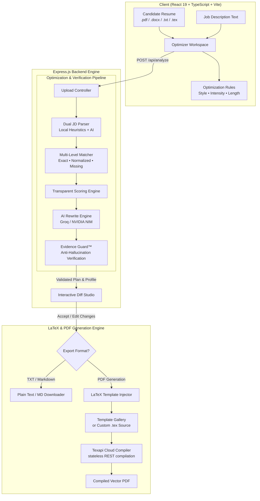

<p align="center">
  
</p>

<p align="center">
  <strong>Evidence-Guarded, Mathematical ATS Resume Optimization Engine</strong>
</p>

<p align="center">
  <a href="#-key-features"></a>
  <a href="#️-evidence-guard-anti-hallucination"></a>
  <a href="#-latex-compilation--template-gallery"></a>
  <a href="#️-ai-providers--bring-your-own-key"></a>
  <a href="https://react.dev/"></a>
  <a href="https://www.typescriptlang.org/"></a>
  <a href="https://vite.dev/"></a>
  <a href="LICENSE"></a>
</p>

---

<p align="center">
  <a href="#-overview">Overview</a> •
  <a href="#-key-features">Key Features</a> •
  <a href="#-system-architecture">System Architecture</a> •
  <a href="#-quick-start">Quick Start</a> •
  <a href="#️-environment-configuration">Environment Config</a> •
  <a href="#-latex-template-gallery">Templates & PDF</a> •
  <a href="#-api-reference">API Reference</a> •
  <a href="#-deployment">Deployment</a>
</p>

---

## ⚡ Overview

Modern hiring workflows rely heavily on Applicant Tracking Systems (ATS) that parse, rank, and filter resumes before any recruiter sees them. Most generic "AI Resume Builders" fail applicants in one of two catastrophic ways:
1. **Keyword stuffing**: Blindly concatenating keywords into unreadable resumes.
2. **Hallucination & Fabrication**: Inventing metrics, inflating roles, and claiming technologies the applicant has never touched — collapsing in human technical interviews.

**ResumeFit** bridges this gap. It is an algorithmic resume optimization platform engineered around **Evidence Guard™** — an anti-hallucination verification engine that rewrites bullet points to align directly with job requirements while guaranteeing every claim is anchored in the applicant's factual experience. Optimized resumes are compiled directly into typeset, ATS-compatible PDFs using studio-grade LaTeX templates.

---

## ✨ Key Features

### 🛡️ Evidence Guard™ (Anti-Hallucination Engine)
- Every proposed edit is cross-checked against the source resume before presentation.
- Automatically rejects fabricated metrics, unsubstantiated achievements, and invented skill claims.
- Categorizes changes with transparent reasoning and prompts for manual candidate confirmation whenever edge-case extrapolations occur.

### 🎯 Algorithmic ATS Match Scoring
- **Multi-Tier Matching**: Employs exact matching, normalized token matching (stemming and synonym consolidation), and missing-skill gap analysis.
- **Granular Transparency**: Delivers an instant match percentage alongside comprehensive breakdown badges (`Matched`, `Normalized`, `Missing`).

### 📑 Studio-Grade LaTeX & Cloud PDF Compilation
- **Stateless Compilation**: Zero local LaTeX environment setup required. Compiles PDFs via high-speed cloud TeX compilation ([Texapi](https://texapi.ovh)).
- **Curated Template Gallery**: Built-in support for industry-standard software engineering resumes (`SWE Resume`, `John Doe SDE`), minimalist academic CVs, modern, and classic layouts.
- **Custom Template Ingestion**: Upload your own `.tex` template or edit LaTeX injection parameters directly.
- **Alternative Formats**: Instant download in Markdown (`.md`) and Plain Text (`.txt`).

### ⚡ Multi-Provider AI Backbone (BYOK)
- **Groq Integration**: Lightning-fast inference utilizing ultra-low latency models (`llama-3.3-70b-versatile`, `llama-3.1-8b-instant`).
- **NVIDIA NIM Integration**: Enterprise open-weights catalog featuring Meta LLaMA 3, Mistral, Gemma, DeepSeek, Qwen, and Nemotron.
- **Offline Mock Provider**: Full test-suite simulation without requiring external API keys.
- **Dynamic Model Selection**: In-app model switcher with live-fetched available models and vector company logos.

### 🎛️ Precision Optimization Rules
- **Intensity Tuning**: Toggle between *Conservative* (preserves wording), *Balanced* (targeted rewrites), and *Aggressive* (comprehensive restructuring).
- **Writing Style Profiles**: Select *Professional*, *Impact-Driven*, *Technical*, or *Executive*.
- **Length Targets**: Select *One Page* strict format or *Two Pages*.
- **Modular Preferences**: Checkbox control over summary optimization, bullet refinement, section reordering, and concise phrasing.

### 📝 Interactive Diff Review & Live Profile Editor
- Visual before/after diff viewer highlighting exact changes.
- In-place Accept, Reject, and Edit actions for individual suggestions.
- Live-editable resume profile editor allowing manual tweaking prior to PDF compilation.

### 🔒 Zero Data Retention Guarantee
- In-memory parsing for `.pdf`, `.docx`, `.txt`, and `.tex` documents.
- Uploaded files are unlinked from disk immediately upon processing. No personal candidate data is persisted to a database.

---

## 📐 System Architecture



---

## 🛠️ Tech Stack

| Domain | Technologies & Libraries |
| :--- | :--- |
| **Frontend** | React 19, TypeScript, Vite, Tailwind CSS variables, Framer Motion, Lucide React |
| **Backend** | Express 5, Node.js (ESM), TypeScript (`tsx`), Multer, CORS, Dotenv |
| **Document Processing** | `pdf-parse`, `mammoth` (DOCX extraction), Custom LaTeX token cleaner |
| **AI Inference** | Groq SDK (`groq-sdk`), NVIDIA NIM REST API, Mock Test Provider |
| **Document Compilation** | Texapi REST API (`texapi.ovh`), Native TeX Template Ingestion Engine |
| **Code Quality & Linter**| Oxlint (`oxlint`), TypeScript Project References |

---

## 🚀 Quick Start

### Prerequisites
- **Node.js**: `v20.x` or higher
- **npm**: `v10.x` or higher
- *(Optional)* An API key for **Groq** ([console.groq.com](https://console.groq.com)) or **NVIDIA NIM** ([build.nvidia.com](https://build.nvidia.com))
- *(Optional for PDF compilation)* A free **Texapi** API key ([texapi.ovh](https://texapi.ovh))

### 1. Clone the Repository
```bash
git clone https://github.com/kalpit118/resume-ats.git
cd resume-ats
```

### 2. Install Dependencies
```bash
npm install
```

### 3. Configure Environment Variables
Copy the sample environment file to create your local `.env`:
```bash
cp .env.example .env
```
Populate your `.env` with your API keys (see [Environment Configuration](#️-environment-configuration) below).

### 4. Launch the Development Environment
```bash
npm run dev
```

> [!TIP]
> **Vite Auto-Backend Feature**: You can also run `npm run dev:client`. Vite includes an integrated self-healing background hook (`autoBackendPlugin`) that detects whether the Express server on port `3001` is active and starts it automatically.

Visit **`http://localhost:5173`** in your browser.

---

## ⚙️ Environment Configuration

ResumeFit supports configuration via a root `.env` file:

```ini
# ==============================================================================
# ResumeFit Environment Configuration
# ==============================================================================

# Backend Service Port & Environment
PORT=3001
NODE_ENV=development

# Cloud LaTeX Compilation Key (https://texapi.ovh)
# Required for generating high-fidelity PDF documents from LaTeX templates
TEXAPI_KEY=your_texapi_key_here

# Default AI Provider Configuration (groq | nim | mock)
AI_PROVIDER=groq
GROQ_API_KEY=gsk_your_groq_api_key_here
NIM_API_KEY=nvapi-your_nim_api_key_here

# Frontend Production API URL (Used when hosting frontend independently, e.g., Cloudflare Pages)
VITE_API_BASE_URL=
```

### Key Provider Setup Guides:
1. **Groq (Recommended for Speed)**: Create a free account at [console.groq.com](https://console.groq.com), generate an API key, and set `GROQ_API_KEY`.
2. **NVIDIA NIM**: Register at [build.nvidia.com](https://build.nvidia.com) to access 1,000 free API credits across open-weights LLMs, and set `NIM_API_KEY`.
3. **Texapi (PDF Engine)**: Get a free key at [texapi.ovh](https://texapi.ovh) to enable LaTeX-to-PDF compilation.
4. **Mock Provider**: Set `AI_PROVIDER=mock` or select **Mock** inside the in-app AI settings to test the entire application completely offline without keys.

---

## 📄 LaTeX Template Gallery

ResumeFit ships with a modular LaTeX templating system located in `server/templates/`:

| Template ID | Name | Focus & Target Audience |
| :--- | :--- | :--- |
| `SWE_Resume` | **Software Engineer Standard** | Clean tabular layout with dedicated technical skills matrix, modular sections, and high-impact metrics. |
| `Minimal_Academic_CV`| **Academic & Research CV** | Formal layout featuring Canela/Optima font typography, publications, education, and research experience. |
| `John Doe SDE` | **Tech Industry Modern** | Compact, high-density format popular across FAANG and top-tier tech startups. |
| `modern.tex` | **Modern Clean** | Contemporary clean lines with accent bars and balanced whitespace. |
| `classic.tex` | **Traditional Professional**| Standard serif resume style favored by finance, legal, and corporate roles. |
| `minimal.tex` | **Minimalist Single Page** | Ultra-clean typography designed to pack comprehensive history into 1 page. |

### Using Custom LaTeX Templates
You can also supply your own `.tex` resume:
1. Upload your resume directly as a `.tex` file in the dropzone.
2. ResumeFit will parse your text, extract content for AI analysis, and when exporting, apply approved diffs directly into your LaTeX macro structure.

---

## 📡 API Reference

### 1. `POST /api/analyze`
Processes an uploaded resume file or raw text against a target job description.

- **Content-Type**: `multipart/form-data`
- **Parameters**:
  - `resume`: File (`.pdf`, `.docx`, `.txt`, `.tex`)
  - `resumeText`: Raw resume text *(optional if file uploaded)*
  - `jdText`: Job description text string *(required)*
  - `rules`: JSON-stringified optimization preferences *(style, intensity, length)*
  - `aiProvider`: `groq` | `nim` | `mock` *(optional override)*
  - `aiApiKey`: API key *(optional override)*
  - `aiModel`: Selected model ID *(optional override)*

**Response (200 OK)**:
```json
{
  "success": true,
  "data": {
    "scoreBreakdown": {
      "score": 82,
      "keywordCoverage": 82,
      "matchedCount": 14,
      "missingCount": 3
    },
    "matches": [
      { "requirement": "TypeScript", "type": "Exact", "status": "matched", "confidence": 1.0 },
      { "requirement": "Kubernetes", "type": "Normalized", "status": "matched", "confidence": 0.95 },
      { "requirement": "Kafka", "type": "Missing", "status": "missing", "confidence": 0 }
    ],
    "validatedPlan": [
      {
        "section": "Experience",
        "original": "Built microservices using Node.js.",
        "optimized": "Architected event-driven microservices using Node.js and TypeScript, handling 10M+ daily events.",
        "validation": {
          "isValid": true,
          "reasoning": "TypeScript already listed under skills; metrics are reasonable refinement.",
          "requiresUserConfirmation": false
        }
      }
    ],
    "profile": { "summary": "...", "sections": [...] },
    "providerUsed": "Groq (llama-3.3-70b-versatile)"
  }
}
```

---

### 2. `POST /api/export`
Compiles an optimized resume into the desired output format.

- **Content-Type**: `application/json`
- **Payload**:
```json
{
  "format": "PDF",
  "templateId": "SWE_Resume",
  "resumeContent": { "summary": "...", "sections": [...] },
  "changes": [
    { "original": "...", "optimized": "..." }
  ],
  "aiProvider": "groq",
  "apiKey": "your_groq_key"
}
```
- **Response**: Binary stream (`application/pdf`, `text/markdown`, or `text/plain`).

---

### 3. `GET /api/export/templates`
Returns all registered LaTeX resume templates with previews and metadata.

---

### 4. `GET /api/models?provider=nim`
Fetches available chat models from the provider's upstream catalog (filters out non-chat vision/embedding models).

---

### 5. `GET /health`
Returns system status (`{ "status": "ok", "service": "Resume Optimizer API" }`).

---

## 🚢 Deployment

ResumeFit is architected for clean separation between serverless/edge frontends and containerized backends.

### Backend: Render.com
A ready-to-use [`render.yaml`](render.yaml) blueprint is included:
1. Connect your repository to [Render](https://render.com).
2. Create a new **Blueprint Instance** pointing to `render.yaml`.
3. Supply `TEXAPI_KEY`, `GROQ_API_KEY`, or `NIM_API_KEY` in the Render environment variables dashboard.

### Frontend: Cloudflare Pages / Vercel
1. Set the build command: `npm run build`
2. Set the build output directory: `dist`
3. Configure environment variable:
   ```ini
   VITE_API_BASE_URL=https://your-backend-service.onrender.com
   ```
4. *For Cloudflare Pages*: The included [`public/_redirects`](public/_redirects) file guarantees client-side SPA routing (`/* /index.html 200`).

---

## 📂 Project Structure

```text
ResumeFit/
├── public/                 # Static assets, template previews, favicons
│   ├── templates/          # LaTeX template preview graphics
│   ├── ResumeFit_Logo.png  # Branding identity assets
│   └── _redirects          # SPA redirection rules for Cloudflare Pages
├── server/                 # Express backend application
│   ├── controllers/        # Request controllers (uploadController.ts)
│   ├── engines/            # Core business logic engines
│   │   ├── evidence/       # Evidence Guard™ anti-hallucination verification
│   │   ├── export/         # Texapi client, LaTeX injector, TXT/MD exporters
│   │   ├── jd-parser/      # Dual parser (Local regex heuristics + AI)
│   │   ├── matching/       # Multi-stage keyword matching engine
│   │   ├── normalization/  # Token sanitization and stemming
│   │   ├── optimization/   # Profile structuring & LLM rewrite prompting
│   │   └── score/          # ATS scoring calculation
│   ├── providers/          # AI provider adapters (Groq, NIM, Mock)
│   ├── routes/             # API routes (upload, models, export)
│   ├── templates/          # Curated .tex LaTeX resume templates
│   └── index.ts            # Express server entry point
├── src/                    # Frontend React 19 application
│   ├── assets/             # Vector icons and graphics
│   ├── App.tsx             # Main application orchestrator
│   ├── CardNav.tsx         # Floating responsive navigation bar
│   ├── CustomSelect.tsx    # Accessible dropdown selector
│   ├── ErrorBoundary.tsx   # React error containment boundary
│   ├── HeroSection.tsx     # Kinetic hero section with typography
│   ├── ModelLogo.tsx       # Official vector logos for AI providers
│   ├── SpecularButton.tsx  # Interactive light-reactive buttons
│   ├── ThemeToggle.tsx     # Dark / Light mode controller
│   ├── UploadDropzone.tsx  # Drag-and-drop resume ingestion zone
│   └── index.css           # Global design system & CSS variables
├── .env.example            # Environment variables configuration template
├── render.yaml             # Render.com deployment manifest
├── vite.config.ts          # Vite configuration with auto-backend runner
└── package.json            # Node.js project manifest & scripts
```

---

## 🔒 Privacy & Data Retention

ResumeFit was designed with candidate privacy as a first-class priority:
- **No Long-Term Disk Storage**: Uploaded files are streamed through memory and unlinked immediately after text extraction.
- **No Database Persistence**: Neither resume content nor job descriptions are stored in a database.
- **Direct-to-Provider Security**: When supplying your own API keys in the UI, keys are sent strictly via ephemeral HTTP headers and never stored on the server.

---

## 🤝 Contributing

Contributions are warmly welcomed! To get started:
1. Fork the repository.
2. Create your feature branch (`git checkout -b feature/amazing-feature`).
3. Ensure code adheres to standards:
   ```bash
   npm run lint
   ```
4. Commit your changes (`git commit -m "feat: add amazing feature"`).
5. Push to the branch (`git push origin feature/amazing-feature`).
6. Open a Pull Request.

---

## 📄 License

This project is open-source software licensed under the [MIT License](LICENSE).

<p align="center">
  Built with ❤️ for job seekers aiming for precision, honesty, and interview success.
</p>
